# Talkivio entity–relationship diagram

_Generated by `apps/api/scripts/er-diagram.mjs` from the migrated database catalog — do not edit by hand._

- 61 tables, 124 foreign keys (71 drawn below).
- 53 tenant-owned tables reference `tenants(id)` through `tenant_id` (not drawn individually); cross-table
  references inside a tenant are composite `(tenant_id, …) → (tenant_id, id)` so a row can never point into another tenant.
- 54 tables have row-level security enabled **and forced** for the application role (ADR 0002).

```mermaid
erDiagram
  agent_capacity {
    col tenant_id PK
    col membership_id PK
  }
  agent_invitations {
    col id PK
  }
  assignment_history {
    col id PK
    col tenant_id FK
    col chat_id FK
  }
  assignment_offers {
    col id PK
    col tenant_id FK
    col target_department_id FK
    col membership_id FK
    col chat_id FK
  }
  attachments {
    col id PK
    col tenant_id FK
    col chat_id FK
  }
  audit_events {
    col id PK
  }
  auth_sessions {
    col id PK
    col user_id FK
  }
  auth_tokens {
    col id PK
  }
  availability_intervals {
    col id PK
    col tenant_id FK
    col membership_id FK
  }
  bans {
    col id PK
    col tenant_id FK
    col site_id FK
    col visitor_id FK
  }
  billing_accounts {
    col tenant_id PK
  }
  billing_events {
    col id PK
  }
  canned_replies {
    col id PK
  }
  chat_participants {
    col id PK
    col tenant_id FK
    col membership_id FK
    col chat_id FK
    col visitor_id FK
  }
  chat_ratings {
    col id PK
    col tenant_id FK
    col chat_id FK
    col visitor_id FK
  }
  chat_tags {
    col tenant_id PK
    col chat_id PK
    col tag_id PK
  }
  chats {
    col id PK
    col tenant_id FK
    col acquisition_department_id FK
    col department_id FK
    col owner_membership_id FK
    col session_id FK
    col site_id FK
    col visitor_id FK
  }
  command_idempotency {
    col id PK
  }
  consent_records {
    col id PK
    col tenant_id FK
    col session_id FK
    col visitor_id FK
  }
  custom_field_definitions {
    col id PK
  }
  department_members {
    col tenant_id PK
    col department_id PK
    col membership_id PK
  }
  departments {
    col id PK
    col tenant_id FK
    col fallback_department_id FK
    col schedule_id FK
  }
  emergency_closures {
    col id PK
    col tenant_id FK
    col department_id FK
    col site_id FK
  }
  exports {
    col id PK
    col tenant_id FK
    col job_id FK
  }
  identity_handoffs {
    col id PK
    col tenant_id FK
    col destination_site_id FK
    col source_site_id FK
    col visitor_id FK
  }
  integration_credentials {
    col id PK
  }
  integration_mappings {
    col id PK
  }
  invitations {
    col id PK
    col tenant_id FK
    col campaign_id FK
    col accepted_chat_id FK
    col session_id FK
    col visitor_id FK
  }
  jobs {
    col id PK
  }
  memberships {
    col id PK
    col user_id FK
  }
  message_attachments {
    col tenant_id PK
    col message_id PK
    col attachment_id PK
  }
  messages {
    col id PK
    col tenant_id FK
    col sender_membership_id FK
    col sender_visitor_id FK
    col chat_id FK
  }
  metric_chat_facts {
    col tenant_id PK
    col chat_id PK
  }
  notifications {
    col id PK
    col tenant_id FK
    col membership_id FK
  }
  oauth_accounts {
    col id PK
    col user_id FK
  }
  offline_submissions {
    col id PK
    col tenant_id FK
    col department_id FK
    col site_id FK
    col visitor_id FK
  }
  outbound_emails {
    col id PK
  }
  outbox_events {
    col seq PK
  }
  page_events {
    col id PK
    col tenant_id FK
    col session_id FK
  }
  privacy_requests {
    col id PK
    col tenant_id FK
    col visitor_id FK
  }
  schedule_exceptions {
    col id PK
    col tenant_id FK
    col schedule_id FK
  }
  schedules {
    col id PK
  }
  site_origins {
    col tenant_id PK
    col site_id PK
    col origin PK
  }
  sites {
    col id PK
    col tenant_id FK
    col default_department_id FK
    col schedule_id FK
  }
  subject_tombstones {
    col id PK
  }
  tags {
    col id PK
  }
  tenants {
    col id PK
    col owner_user_id FK
  }
  trigger_effects {
    col id PK
    col tenant_id FK
    col run_id FK
  }
  trigger_revisions {
    col id PK
    col tenant_id FK
    col trigger_id FK
  }
  trigger_runs {
    col id PK
    col tenant_id FK
    col trigger_id FK
  }
  triggers {
    col id PK
  }
  trusted_devices {
    col id PK
    col user_id FK
  }
  users {
    col id PK
  }
  visitor_credentials {
    col id PK
    col tenant_id FK
    col visitor_id FK
  }
  visitor_identities {
    col id PK
    col tenant_id FK
    col visitor_id FK
  }
  visitor_sessions {
    col id PK
    col tenant_id FK
    col site_id FK
    col visitor_id FK
  }
  visitor_tags {
    col tenant_id PK
    col visitor_id PK
    col tag_id PK
  }
  visitors {
    col id PK
    col tenant_id FK
    col site_id FK
  }
  webhook_deliveries {
    col id PK
    col tenant_id FK
    col endpoint_id FK
  }
  webhook_endpoints {
    col id PK
  }
  widget_configs {
    col id PK
    col tenant_id FK
    col site_id FK
  }
  memberships ||--o{ agent_capacity : "membership_id"
  chats ||--o{ assignment_history : "chat_id"
  departments |o--o{ assignment_offers : "target_department_id"
  memberships |o--o{ assignment_offers : "membership_id"
  chats ||--o{ assignment_offers : "chat_id"
  chats |o--o{ attachments : "chat_id"
  users ||--o{ auth_sessions : "user_id"
  memberships ||--o{ availability_intervals : "membership_id"
  sites |o--o{ bans : "site_id"
  visitors |o--o{ bans : "visitor_id"
  memberships |o--o{ chat_participants : "membership_id"
  chats ||--o{ chat_participants : "chat_id"
  visitors |o--o{ chat_participants : "visitor_id"
  chats ||--o{ chat_ratings : "chat_id"
  visitors ||--o{ chat_ratings : "visitor_id"
  tags ||--o{ chat_tags : "tag_id"
  chats ||--o{ chat_tags : "chat_id"
  departments |o--o{ chats : "acquisition_department_id"
  departments |o--o{ chats : "department_id"
  memberships |o--o{ chats : "owner_membership_id"
  visitor_sessions |o--o{ chats : "session_id"
  sites ||--o{ chats : "site_id"
  visitors ||--o{ chats : "visitor_id"
  visitor_sessions |o--o{ consent_records : "session_id"
  visitors |o--o{ consent_records : "visitor_id"
  departments ||--o{ department_members : "department_id"
  memberships ||--o{ department_members : "membership_id"
  departments |o--o{ departments : "fallback_department_id"
  schedules |o--o{ departments : "schedule_id"
  departments |o--o{ emergency_closures : "department_id"
  sites |o--o{ emergency_closures : "site_id"
  jobs ||--o{ exports : "job_id"
  sites ||--o{ identity_handoffs : "destination_site_id"
  sites ||--o{ identity_handoffs : "source_site_id"
  visitors ||--o{ identity_handoffs : "visitor_id"
  triggers ||--o{ invitations : "campaign_id"
  chats |o--o{ invitations : "accepted_chat_id"
  visitor_sessions ||--o{ invitations : "session_id"
  visitors ||--o{ invitations : "visitor_id"
  users ||--o{ memberships : "user_id"
  attachments ||--o{ message_attachments : "attachment_id"
  messages ||--o{ message_attachments : "message_id"
  memberships |o--o{ messages : "sender_membership_id"
  visitors |o--o{ messages : "sender_visitor_id"
  chats ||--o{ messages : "chat_id"
  chats ||--o{ metric_chat_facts : "chat_id"
  memberships ||--o{ notifications : "membership_id"
  users ||--o{ oauth_accounts : "user_id"
  departments |o--o{ offline_submissions : "department_id"
  sites ||--o{ offline_submissions : "site_id"
  visitors |o--o{ offline_submissions : "visitor_id"
  visitor_sessions ||--o{ page_events : "session_id"
  visitors |o--o{ privacy_requests : "visitor_id"
  schedules ||--o{ schedule_exceptions : "schedule_id"
  sites ||--o{ site_origins : "site_id"
  departments |o--o{ sites : "default_department_id"
  schedules |o--o{ sites : "schedule_id"
  users ||--o{ tenants : "owner_user_id"
  trigger_runs ||--o{ trigger_effects : "run_id"
  triggers ||--o{ trigger_revisions : "trigger_id"
  triggers ||--o{ trigger_runs : "trigger_id"
  users ||--o{ trusted_devices : "user_id"
  visitors ||--o{ visitor_credentials : "visitor_id"
  visitors ||--o{ visitor_identities : "visitor_id"
  sites ||--o{ visitor_sessions : "site_id"
  visitors ||--o{ visitor_sessions : "visitor_id"
  tags ||--o{ visitor_tags : "tag_id"
  visitors ||--o{ visitor_tags : "visitor_id"
  sites ||--o{ visitors : "site_id"
  webhook_endpoints ||--o{ webhook_deliveries : "endpoint_id"
  sites ||--o{ widget_configs : "site_id"
```

## Row-level security
`agent_capacity`, `agent_invitations`, `assignment_history`, `assignment_offers`, `attachments`, `audit_events`, `availability_intervals`, `bans`, `billing_accounts`, `canned_replies`, `chat_participants`, `chat_ratings`, `chat_tags`, `chats`, `command_idempotency`, `consent_records`, `custom_field_definitions`, `department_members`, `departments`, `emergency_closures`, `exports`, `identity_handoffs`, `integration_credentials`, `integration_mappings`, `invitations`, `jobs`, `memberships`, `message_attachments`, `messages`, `metric_chat_facts`, `notifications`, `offline_submissions`, `outbox_events`, `page_events`, `privacy_requests`, `schedule_exceptions`, `schedules`, `site_origins`, `sites`, `subject_tombstones`, `tags`, `tenants`, `trigger_effects`, `trigger_revisions`, `trigger_runs`, `triggers`, `visitor_credentials`, `visitor_identities`, `visitor_sessions`, `visitor_tags`, `visitors`, `webhook_deliveries`, `webhook_endpoints`, `widget_configs`
